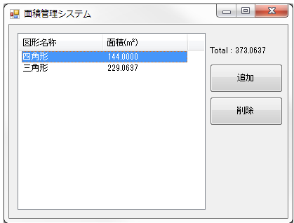
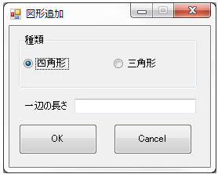

# 面積管理システム

図形と辺の長さを追加し、追加した図形の面積および図形の合計面積を出力するシステム

背景：FE研修の題材として面積管理システムを作成

## 画面一覧

### メイン画面

- 図形の一覧表示
- 合計面積表示
- 追加ボタン
- 削除ボタン

### サブ画面

- 追加フォーム
  - ラジオボタン
  - フォーム
  - OK/キャンセルボタン

## 機能

- 図形の一覧表示
- 合計面積の表示
- 図形追加
- 図形削除
